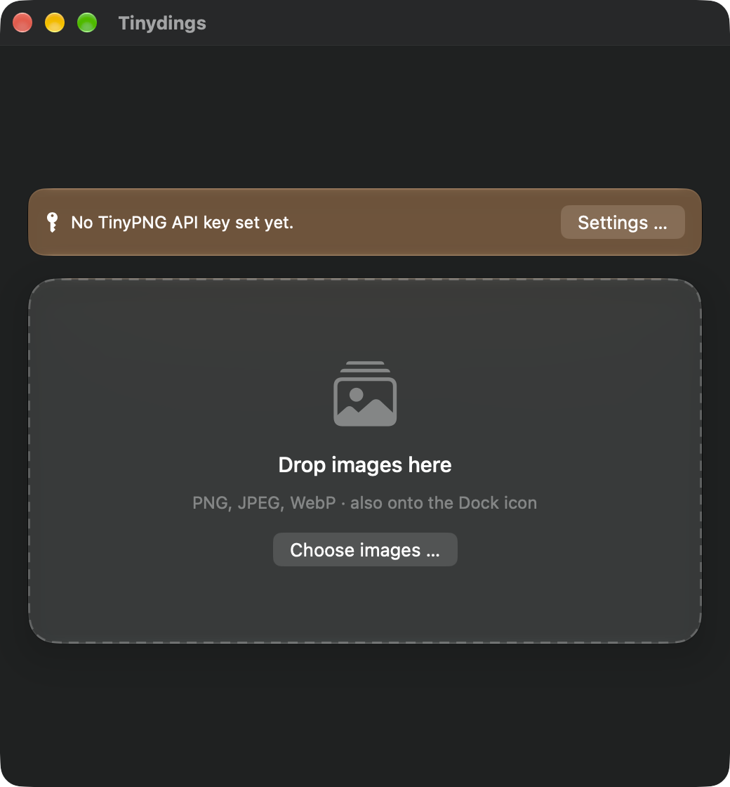

  

<h1 align="center">Tinydings</h1>

  A small, free Mac app that compresses images by drag &amp; drop using the <a href="https://tinypng.com/developers">TinyPNG API</a>. 
  Requires macOS 26 or later

  

  <a href="../../releases/latest"><b>⬇︎ Download the latest version</b></a>

## Features

- Drop a batch of images (PNG, JPEG, WebP) onto the window **or onto the Dock icon**
- Per-file status, size before/after and savings, plus the total savings
- Configurable output: **overwrite the original** (optionally moving the original to the Trash first) or **write to a subfolder** (default `tiny`, name is configurable)
- If an image doesn't get smaller, the original is left untouched
- Any number of images at once, processed 4 at a time (the rest wait in the list)
- Your own TinyPNG API key, stored in the Keychain
- Interface in English and German, switchable in the settings

## Installation

1. Download the zip of the [latest release](../../releases/latest) and unzip it.
2. Drag `Tinydings.app` into your Applications folder.
3. On first launch macOS blocks the app because it is not notarized: System Settings → Privacy & Security → "Open Anyway", or run `xattr -cr /Applications/Tinydings.app` in Terminal.
4. Open the settings (⌘,) and enter your own API key. "Test key" checks it. You can get a free key from [TinyPNG](https://tinify.com/developers) (500 images per month).

## Usage

Drop images onto the window or the Dock icon, or use "Choose images …". The list shows size before and after and the savings for each file. In the settings you choose whether originals are overwritten or saved to a subfolder, and the interface language.

Please report bugs and requests as an [issue](../../issues).

## License and source code

Tinydings is free and released under the [MIT License](LICENSE). The source code is not public.

## Notes and disclaimer

- **Not affiliated with TinyPNG:** Tinydings is an independent project. It is not affiliated with, endorsed by, or operated by TinyPNG or Tinify. "TinyPNG" and "Tinify" are trademarks of their respective owners. The app merely uses the publicly documented [TinyPNG API](https://tinypng.com/developers).
- **Your own API key, your own responsibility:** Tinydings does not include a key. You enter your own TinyPNG API key and are responsible for it: for keeping it secret, for your quota (500 compressions per month on the free plan) and for any costs if you use a paid plan. Do not share your key. The app stores it in your Keychain and sends it only to the TinyPNG API.
- **Your images are sent to TinyPNG:** To compress them, images are uploaded to TinyPNG's servers. Their terms of service and privacy policy apply. Do not send anything you are not allowed or willing to have processed there.
- **Originals:** In "Overwrite original" mode the file is replaced. Enable the Trash option or work on copies if needed.
- **No warranty:** The software is provided "as is", without warranty of any kind, and you use it at your own risk. This is a beta.
