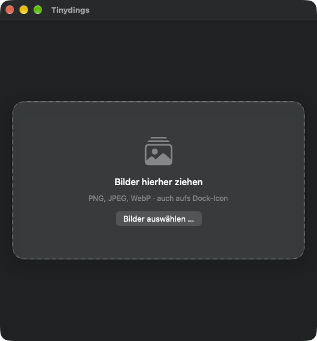

  

<h1 align="center">Tinydings</h1>

  Kleine, kostenlose Mac-App, die Bilder per Drag &amp; Drop über die <a href="https://tinypng.com/developers">TinyPNG-API</a> komprimiert. 
  macOS 26 oder neuer

  

  <a href="../../releases/latest"><b>⬇︎ Neueste Version herunterladen</b></a>

## Funktionen

- Stapel von Bildern (PNG, JPEG, WebP) ins Fenster **oder aufs Dock-Icon** ziehen
- Je Datei Status, Größe vorher/nachher und Ersparnis, dazu die Gesamtersparnis
- Ausgabe einstellbar: **Original überschreiben** (optional Original vorher in den Papierkorb) oder **in Unterordner schreiben** (Standard `tiny`, Name änderbar)
- Wird ein Bild nicht kleiner, bleibt das Original unverändert
- Beliebig viele Bilder auf einmal, verarbeitet werden jeweils 4 parallel (die übrigen warten in der Liste)
- Eigener TinyPNG-API-Key, abgelegt in der Keychain
- Oberfläche auf Deutsch und Englisch, umschaltbar in den Einstellungen

## Installation

1. Das Zip der [neuesten Version](../../releases/latest) laden und entpacken.
2. `Tinydings.app` in den Ordner „Programme" ziehen.
3. Beim ersten Start blockiert macOS die App, weil sie nicht notarisiert ist: Systemeinstellungen → Datenschutz & Sicherheit → „Dennoch öffnen", oder im Terminal `xattr -cr /Applications/Tinydings.app`.
4. Einstellungen öffnen (⌘,) und den eigenen API-Key eintragen. „Key testen" prüft ihn. Einen kostenlosen Key gibt es bei [TinyPNG](https://tinify.com/developers) (500 Bilder pro Monat).

## Benutzung

Bilder ins Fenster oder aufs Dock-Icon ziehen, alternativ „Bilder auswählen …". Die Liste zeigt je Datei die Größe vorher und nachher und die Ersparnis. In den Einstellungen wählst du, ob die Originale überschrieben oder in einem Unterordner abgelegt werden, und die Sprache.

Fehler und Wünsche gern als [Issue](../../issues) melden.

## Lizenz und Quellcode

Tinydings steht unter der [MIT-Lizenz](LICENSE). Der Quellcode wird nicht veröffentlicht, dieses Repository enthält nur die App als Download.

## Hinweise und Haftungsausschluss

- **Keine Verbindung zu TinyPNG:** Tinydings ist ein unabhängiges Projekt und steht in keiner Verbindung zu TinyPNG bzw. Tinify, wird nicht von ihnen unterstützt, empfohlen oder betrieben. „TinyPNG" und „Tinify" sind Marken ihrer jeweiligen Inhaber. Die App nutzt lediglich die öffentlich dokumentierte [TinyPNG-API](https://tinypng.com/developers).
- **Eigener API-Key, eigene Verantwortung:** Tinydings enthält keinen Key. Du trägst deinen eigenen TinyPNG-API-Key ein und bist selbst für ihn verantwortlich: für seine Geheimhaltung, für das Kontingent (im kostenlosen Tarif 500 Komprimierungen pro Monat) und für mögliche Kosten, wenn du ein kostenpflichtiges Kontingent nutzt. Gib deinen Key nicht weiter. Die App speichert ihn in deiner Keychain und sendet ihn nur an die TinyPNG-API.
- **Deine Bilder gehen an TinyPNG:** Zum Komprimieren werden die Bilder an die Server von TinyPNG übertragen. Es gelten deren Nutzungsbedingungen und Datenschutzhinweise. Sende nichts, was du dort nicht verarbeiten lassen darfst oder willst.
- **Originale:** Im Modus „Original überschreiben" wird die Datei ersetzt. Aktiviere bei Bedarf die Papierkorb-Option oder arbeite mit Kopien.
- **Keine Gewähr:** Die Software wird ohne Mängelgewähr bereitgestellt, die Nutzung erfolgt auf eigenes Risiko. Es ist eine Beta.
